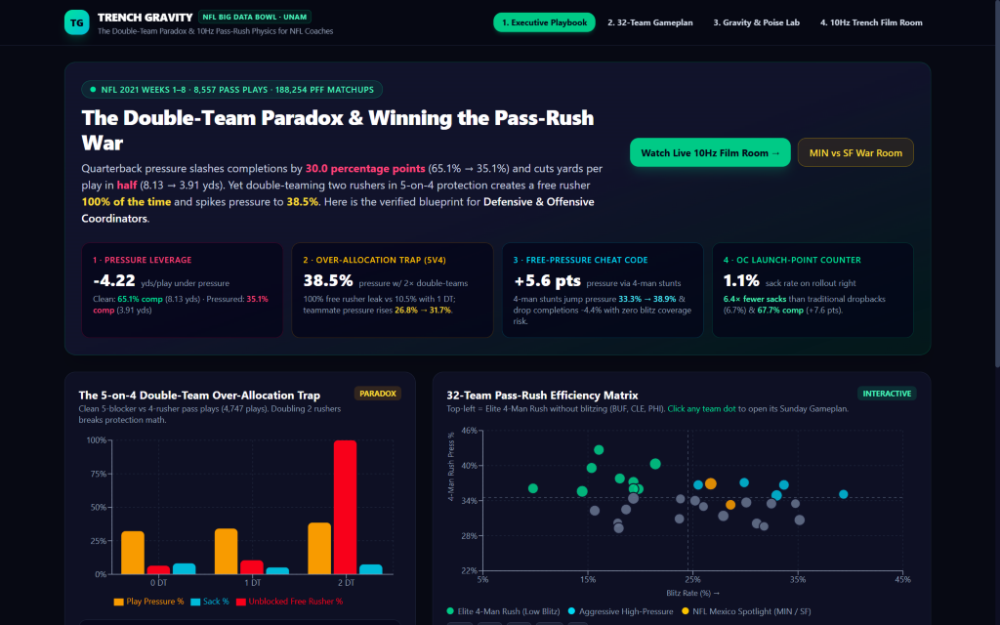

# TRENCH GRAVITY — The Double-Team Paradox & 10Hz Pass-Rush Physics

> **Hackathon NFL Big Data Bowl · UNAM (2026)**
> Interactive war-room analytics & 10Hz player-tracking film room built from **8,557 pass plays**, **188,254 PFF blocker-rusher matchups**, and **122 games of 10Hz NFL Next Gen Stats tracking** (2021 Season, Weeks 1–8).



---

## 1. Main Finding: The Double-Team Paradox

Quarterback pressure is the single largest lever in the NFL passing game: across 8,557 pass plays, pressure cuts completion rate by **30.0 percentage points** (**65.1% → 35.1%**), slices yards per play in **half** (**8.13 → 3.91 yds/play**), and spikes sack rate from **0.1% → 16.8%**.

Conventional football wisdom assumes double-teaming an elite pass rusher neutralizes the front—after all, a double-teamed defender's individual pressure rate drops from **13.4% → 6.9%** on 4-man rushes. **Our analysis reveals the hidden paradox:**

| Protection Allocation (Clean 5v4, 4,747 plays) | Plays | Unblocked Free Rusher % | Play Pressure % | Sack % | Completion % |
|---|---:|---:|---:|---:|---:|
| **0 Double-Teams** (All 1-on-1) | 267 | 6.4% | 32.2% | 8.2% | 58.4% |
| **1 Double-Team** (Balanced 5v4) | 3,699 | 10.5% | 34.1% | 5.1% | 56.1% |
| **2 Double-Teams** (Over-Committed) | 781 | **100.0%** | **38.5%** | **7.4%** (+45%) | **52.9%** |

Even on a standard 4-man rush, whenever an offense double-teams a high-gravity defender, **teammate pressure jumps from 26.8% → 31.7% (+4.9 pts)** and overall play pressure still rises (**34.5% → 35.0%**).

### The "Invisible Box-Score Superstars" Uncovered by Trench Gravity
Traditional sack totals completely miss interior defenders who warp protection math for an entire defense:
- **Star Lotulelei (BUF):** Only **2 sacks**, yet **70.3% double-team rate** → **43.8% teammate pressure** (#1 Trench Gravity Score: **99.0**).
- **Vita Vea (TB):** Only **1 sack**, yet **56.0% double-team rate** → **47.5% teammate pressure** (**94.0** Gravity Score).
- **Justin Zimmer (BUF):** Only **1 sack**, yet **71.4% double-team rate** → **40.0% teammate pressure** — fueling Buffalo's **#1 4-man rush in the NFL (42.7% pressure on just a 16.1% blitz rate)**.
- **Myles Garrett (CLE):** **12 sacks**, **21.2% self-pressure**, and **51.9% teammate pressure** whenever double-teamed.

---

## 2. Audience & Actionable Sunday Playbook

Built directly for **NFL Defensive Coordinators, Offensive Coordinators, and Front-Office Scouts**:

### For Defensive Coordinators (How to Collapse the Pocket)
1. **Use 4-Man Stunts/Twists (`SW`) as Free Pressure:** Stunts on 4-man fronts lift pressure **33.3% → 38.9% (+5.6 pts)** and drop completions **-4.4 pts** with zero extra coverage risk. Pairing **Blitz + Stunt** pushes sack rate to **10.7%**.
2. **Stop Wasting Early-Down Blitzes — Unleash on 3rd & Long (7+):** Blitzing on 1st/2nd down saves **0.00 yards/play** (6.72 vs. 6.75 yds). Saving the blitz for **3rd & 7+** spikes pressure to **60.5%** and increases sacks by **+67% (9.1% → 15.2%)**.
3. **Attack the Exact Weakest O-Line Lane:** Our **32-Team Sunday Gameplan** exposes each opponent's exact 5-lane vulnerability (`LT`, `LG`, `C`, `RG`, `RT`) — e.g., targeting Minnesota's `LT` (Rashod Hill: **8.7% pressure allowed, 3 sacks**) instead of `RT` (Brian O'Neill: **2.0%**, 0 sacks), and dialing up stunts against Minnesota (**+12.9 pts** pressure jump: 33.9% → 46.8%).


### For Offensive Coordinators (How to Beat Trench Gravity)
1. **Move the Launch Point (Designed Rollout Right):** Slashes sack rate **6.4×** (**6.7% → 1.1%**) and lifts completion rate to **67.7% (+7.6 pts)** by outflanking interior gravity.
2. **Never Over-Commit to Two Double-Teams in 5-Man Protection:** Leaves an unblocked free rusher **100% of the time** (38.5% pressure).
3. **Skip Static 6-Man Pockets — Use Play-Action & 7-Man Max Protect:** Play-Action adds **+1.76 yds/play** on 4-man rushes (**6.12 → 7.88 yds**), while 7-man Max Protect cuts pressure to **28.4%** at **7.85 yds/play**.

---

## 3. Live 10Hz 2D Trench Film Room

Select any of the **8 curated showcase plays** (or filter all **8,557 plays** across all 32 teams) to stream on-demand 10Hz tracking from `data/tracking/tracking_<gameId>.csv`:
- **Animated SVG NFL Field** (normalized left → right) with jersey numbers, body-orientation vectors (`o`), **gold double-team matchup lines** (`pff_nflIdBlockedPlayer`), **pulsing crimson free-rusher alerts**, and a **live shrinking QB pocket bubble**.
- **Synced 10Hz Physics Telemetry Chart** plotting real-time **QB Pocket Radius (yds)** and **Peak Rusher Closing Speed (yds/sec)** frame by frame.
- **Optional Amazon Nova Pro (AWS Bedrock) Coach's Brief** generating custom team/play scouting summaries with a zero-dependency deterministic fallback when Bedrock credentials are unavailable.


---

## 4. Architecture & Fixed Stack Compliance

- **Backend (`backend/`):** FastAPI `0.115.14`, Uvicorn `0.34.3`, Pydantic `2.11.7`, pandas `2.2.3`, numpy `2.1.3`, optional Amazon Bedrock (`boto3` `1.44.0`, `us.amazon.nova-pro-v1:0`). Preloads summary CSVs once at startup and serves 10Hz game tracking on demand via an in-memory LRU cache (zero disk writes, read-only `data/`).
- **Frontend (`dashboard/`):** React `18.3.1`, Vite `5.4.21` (`base: './'`), TypeScript `5.7.3`, Tailwind CSS `3.4.19`, Recharts `3.10.1`. All API requests use relative paths without a leading slash (`fetch('api/...')`).
- **API Endpoints:** `GET /health`, `GET /api/overview`, `GET /api/players`, `GET /api/team/{team}`, `GET /api/plays`, `GET /api/play/{game_id}/{play_id}/tracking`, `POST /api/coach-brief`.

## 5. How to Run Locally

```powershell
# 1. Validate isolated hackathon environment
.\.hackathon\setup.cmd --check

# 2. Start Backend (Terminal 1)
.\.venv\Scripts\uvicorn backend.main:app --reload

# 3. Start Dashboard (Terminal 2) — open http://localhost:5173
cd dashboard
npm run dev

# 4. Generate verified submission zip
.\.hackathon\setup.cmd --entregar
```
