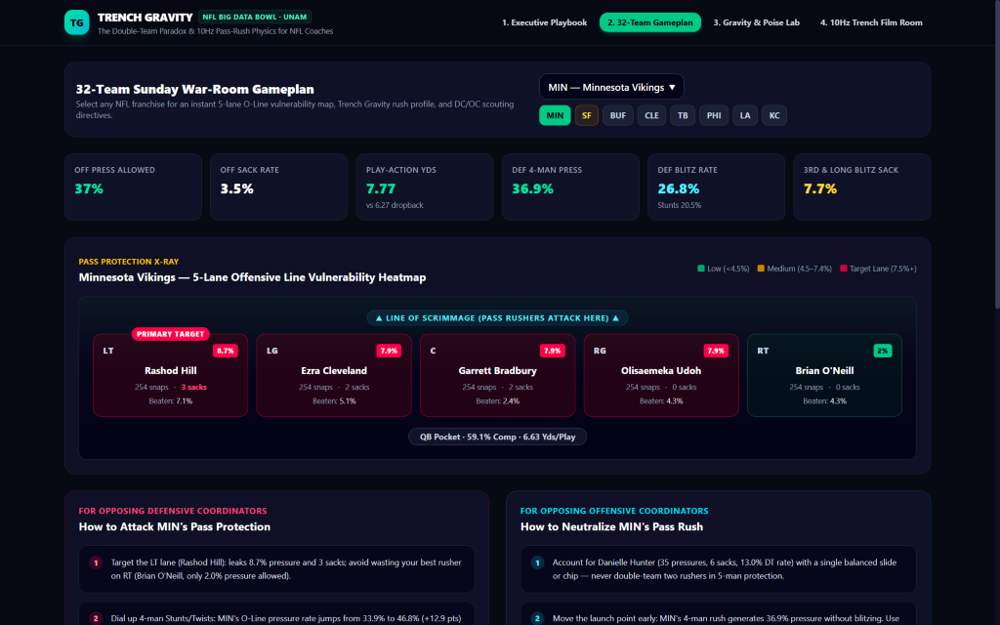
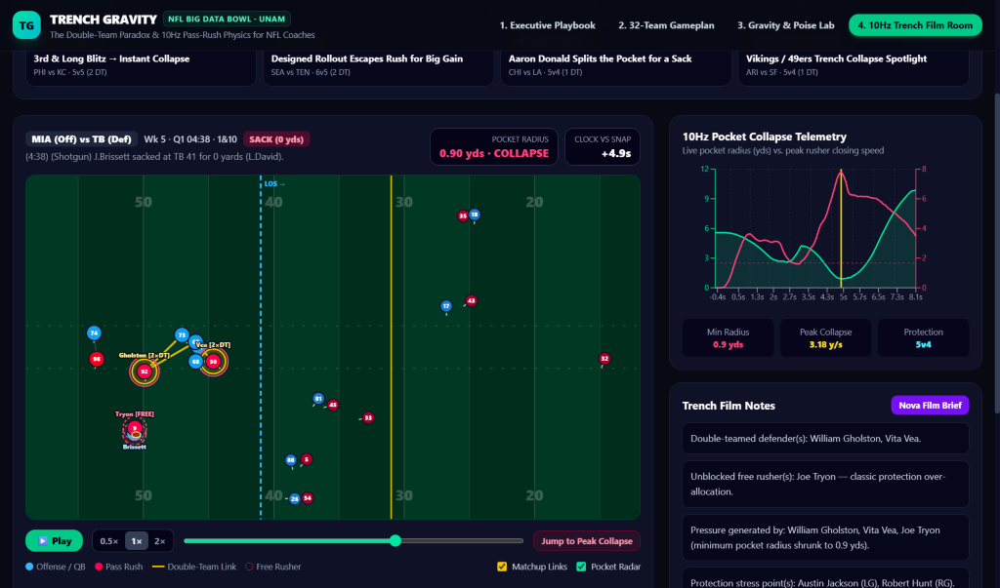

# La Guerra de los 3.5 Segundos

> **Cómo ganar (o robar) décimas de segundo en cada pase** · NFL 2021, semanas 1–8 · Hackathon NFL Big Data Bowl, UNAM

Cada pase es una carrera entre dos relojes: el del quarterback y el de los pass rushers. Medimos esa carrera con tracking a 10 Hz (**8,557 pases, 36,263 arranques de rusher, 122 juegos**) y la convertimos en decisiones concretas para coordinadores y jugadores.

## Hallazgo principal

**Pasados 3.5 segundos, el pase entra en zona de peligro, y la carrera se gana por décimas.** Cada medio segundo que el QB sostiene el balón, el riesgo de sack se multiplica ~2.4×: de 5.1% (3.0–3.5 s) a 13.2% (3.5–4.0 s) y a 23.4% (4–5 s). Un rusher que arranca 0.1 s antes que su propio promedio suma ~0.9 puntos de presión (≈8% relativo), y el play action congela 0.12 s a cada rusher.

| Hallazgo | Evidencia (ajustada: misma down y distancia, mismo jugador) | Confianza |
|---|---|:---:|
| **Zona de peligro después de 3.5 s** | Sacks: 1.9% antes vs 19.2% después; éxito: 52.8% → 35.9%. Uno de cada cuatro pases (25.5%) llega ahí | 🟢 |
| **El get-off gana** | Mismo jugador: 0.3 s antes que su mediana → 21.3% de presión; 0.3 s después → 7.4%. Es la métrica más estable del dataset (0.79 entre mitades de temporada) | 🟢 |
| **El play action es el arma de la jugada grande** | Jugadas de 20+ yardas: 13.6% vs 7.7% esperado (1.8×), con el mismo éxito (54.1% vs 54.1%). El costo: más presión (37.8% vs 30.5%) | 🟢 |
| **El blitz depende del down** | Ayuda en 1ro/2do (−2.3 pts de éxito rival) y en 3ro corto (−5.2). En 3ro y 7+ da más sacks (9.5% → 15.1%) pero **+4.5 pts de conversiones**, y ahí es justo donde más se usa (30% vs 22%) | 🟡 |


## Para quién y qué decisión cambia

| Quién | Decisión | Respaldo |
|---|---|---|
| **Coordinador defensivo** | Blitz en 1ro/2do y 3ro corto, **no** en 3ro y largo. Ahí, rush de 4 con stunt | En 3ro y 7+, vs rush de 4 sin stunt (29.4% de conversión, n=541): 4 con stunt −4.6 pts (ee 3.1, muestra chica); blitz sin stunt −0.7; blitz con stunt +4.7 |
| | Entrena y mide el get-off de cada rusher contra su propia mediana | 0.7–1.2 pts de presión por cada 0.1 s, con cualquier control (tabla abajo) |
| | Ataca el carril más débil de la línea rival | El plan de juego de cada equipo muestra presión permitida por carril con su `n` (tendencia: se repite en 12 de 32 equipos, ~2× el azar) |
| **Coordinador ofensivo** | Play action para la jugada grande, con rollout diseñado para bajar los sacks | PA + rollout: 2.7% de sacks (10 de 365) vs 7.2% del PA sin rollout |
| | No dejes al corredor solo recogiendo blitz | El RB que recoge blitz pierde 26.0% de sus duelos (800 duelos) vs 13.8% de la línea. Mandarlo a la ruta contra blitz no empeora: +4.0 pts de éxito (ee 2.4) |
| | Diseña lecturas que salgan antes de 3.5 s | Liga: 52.8% de éxito antes vs 35.9% después |
| **Jugadores** | Rusher: mejora tu get-off personal (comparado dentro de tu grupo: Edge ~0.75 s, Interior ~0.83 s) | Edge: +1.6 pts de presión por 0.1 s; Interior: +0.8 (con controles) |
| | QB: controla cuánto sostienes el balón | El % de pases > 3.5 s es un rasgo del QB: se repite entre mitades de temporada (0.64) |

### La app

1. **El Reloj**: el hallazgo principal con sus cuatro tarjetas, la curva de la zona de peligro, el get-off dentro del mismo jugador, los planes de rush ajustados, el blitz por situación y el play action comparado contra lo esperado.
2. **Plan de Juego (32 equipos)**: mapa de calor de los 5 carriles de la línea ofensiva (con `n` y presiones), el reloj del QB rival, el get-off de su defensa (tendencia), su uso de play action y pistas automáticas en español para ambos lados del balón. Botón opcional de **resumen del coordinador con Amazon Nova** (si la IA no está disponible, la app genera el mismo resumen con los datos).
3. **Laboratorio de Jugadores**: get-off de cada pass rusher con filtro `Todos / Edge / Interior`, columna "Strain (tipo STRAIN)", relojes de los QB y ranking de la línea ofensiva.
4. **Sala de Video 10 Hz**: cada jugada animada con un **reloj del pocket** (verde < 2.5 s, ámbar 2.5–3.5 s, rojo > 3.5 s), telemetría con las marcas de 3.5 s y del lanzamiento, el get-off de cada rusher en esa jugada y 8 jugadas destacadas.
5. **Cómo leer esto**: glosario para quien no conoce la NFL. *Piensa en el fútbol: el get-off es el arranque del delantero al espacio; el play action es el amague.*

## Cómo lo medimos

- **Datos**: NFL Big Data Bowl 2023: 8,557 dropbacks, 188,254 filas de scouting de PFF y tracking a 10 Hz de 122 juegos (811 MB), del snap al final del dropback.
- **Pipeline reproducible**: [backend/pipeline/build_tracking_features.py](backend/pipeline/build_tracking_features.py) recorre el tracking y calcula, por jugada, el tiempo de lanzamiento y, por rusher, el get-off, la velocidad a 0.5 s, el strain y la distancia mínima al QB. La API carga esos archivos al arrancar y calcula todo en memoria. **Ningún número está escrito a mano**: todos salen de `GET /api/guerra`, `/api/qb-clocks`, `/api/players` y `/api/team/{equipo}`.
- **Definiciones**: *presión* = golpe, apuro o sack; *éxito* = ganar 40% de la distancia en 1er down, 60% en 2do y 100% en 3ro/4to; *jugada grande* = 20+ yardas; *blitz* = 5+ rushers; *stunt* = la jugada tiene un switch (`SW`); *get-off* = segundos tras el snap hasta que el rusher se movió 1 yarda; *% de completos* = completos / intentos (sin contar sacks ni scrambles). Excluimos los 35 intentos de 2 puntos de todo cálculo de éxito.
- **Comparar lo comparable**: todo lo que se usa más en un down que en otro (play action, blitz, stunts) se compara a la **misma down y yardas por avanzar exactas**, con errores estándar estratificados. Las métricas de jugador se miden **contra el propio jugador** (efectos fijos) y los rankings, **dentro de su grupo de posición**.
- **El get-off resiste todos los controles** (puntos de presión por cada 0.1 s más rápido; base 11.0%; errores agrupados por jugador):

| Controles | pts por 0.1 s | z |
|---|---:|---:|
| Mismo jugador | 0.87 | 9.3 |
| + down y distancia exacta | 0.70 | 7.4 |
| + franja de tiempo de lanzamiento | 1.23 | 12.2 |
| + play action | 1.08 | 9.9 |
| + blitz / stunt | 1.07 | 9.8 |
| Contra sus compañeros en el mismo snap | 0.89 | 7.4 |

- **Estabilidad**: solo mostramos como rasgo lo que se repite entre las semanas 1–4 y 5–8: get-off del jugador 0.79 · % de pases del QB > 3.5 s 0.64 · tiempo mediano del QB 0.50 · presión propia del rusher 0.31 (moderada). El get-off promedio de una defensa (0.42) y el carril débil de una línea se muestran como **tendencia**.
- **Nota honesta**: 3.5 s es un umbral útil, no un precipicio. El éxito cae de forma continua (~8 pts por segundo) y un quiebre en 3.5 s no mejora de forma significativa a una recta (F = 2.9, p ≈ 0.09). Lo que crece rápido es el riesgo de sack: ×3.3, ×2.5, ×2.6 y ×1.6 en cada medio segundo entre 2.0 y 4.5 s.

## Lo que descartamos

Hipótesis que probamos y no pasaron nuestro estándar de evidencia:

- **"Dos dobles en 5 contra 4 dejan un rusher libre el 100% de las veces"**: es aritmética (781 de 781 jugadas no podían salir distinto), y 53% de esas jugadas son stunts mal registrados, porque PFF solo anota el primer defensor que toca cada bloqueador.
- **"Trench Gravity" (estrellas invisibles que atraen dobles)**: la presión de los compañeros cuando el jugador recibe doble no se repite entre mitades de temporada (−0.12).
- **"El blitz en 3ro y largo es el golpe de gracia"**: da más sacks, pero también más conversiones (+4.5 pts a la misma distancia).
- **"El rollout a la derecha da 6.4× menos sacks"**: escogido a conveniencia (derecha 1.1%, n=285; izquierda 5.4%, n=149). Lo defendible: rollouts diseñados de ambos lados, 2.5% vs 6.7% del pocket tradicional.
- **"El play action sube el éxito de 47% a 54%"**: es un artefacto del down (40% de los pases de 1ro son play action vs 4% en 3ro, y en 1ro la vara es más baja). A la misma down y distancia: 54.1% vs 54.1%. Tampoco es cierto que "no cuesta presión": ajustado, son +7.3 pts.
- **"Cada QB tiene su propio reloj"**: la caída de éxito de cada QB después de 3.5 s no se repite entre mitades (−0.14). Lo que sí es rasgo es cuánto sostiene el balón.
- **"Los tackles pesados pierden contra rushers ligeros"** (15.0% vs 6.5% de duelos perdidos): confusión por tipo de rusher (96% de esos rivales son edges vs 14%). Con el mismo rusher, un tackle más pesado pierde **menos** (−0.9 pts por cada 10 lb, z −3.3).
- **"Presión fantasma"** (un rusher a 2–3 yd sin llegar baja los completos: 64.9% vs 71.0%): casi todo es el reloj. Dentro de la misma franja de tiempo de lanzamiento la brecha baja a −2.6 pts y deja de ser significativa (ee 1.5).
- **Fatiga del rusher**: la presión *sube* con los snaps del juego (11.3% en los primeros 10 vs 15.2% después de 30), incluso para el mismo jugador.
- **Ruido del estadio**: efecto mínimo (presión permitida 37.7% de local vs 36.6% de visitante).
- **Vulnerabilidad de un equipo a los stunts**: no se repite entre mitades (0.15).

## Cómo correrlo

```powershell
# 1. Verificar el entorno
.\.hackathon\setup.cmd --check

# 2. Backend (terminal 1), puerto 8000
.\.venv\Scripts\uvicorn backend.main:app --reload

# 3. Dashboard (terminal 2): abre http://localhost:5173
cd dashboard
npm run dev
```

Los archivos de [backend/precomputed/](backend/precomputed/) ya vienen incluidos. Para regenerarlos desde el tracking (~1–2 min): `.\.venv\Scripts\python -m backend.pipeline.build_tracking_features`.

**Stack**: FastAPI + pandas en `backend/` (sin escrituras a disco; `data/` es solo lectura) y React + Vite + TypeScript + Tailwind 3 + Recharts en `dashboard/`. IA opcional con Amazon Bedrock (Amazon Nova): la app muestra su hallazgo completo aunque la IA no esté disponible.

**API**: `GET /health` · `/api/guerra` · `/api/qb-clocks` · `/api/players` · `/api/team/{equipo}` · `/api/plays` · `/api/play/{gameId}/{playId}/tracking` · `POST /api/coach-brief`.

## Capturas

**Plan de Juego**: carriles de la línea ofensiva, reloj del QB rival y pistas para ambos lados del balón.



**Sala de Video 10 Hz**: el reloj del pocket en rojo después de 3.5 s.


