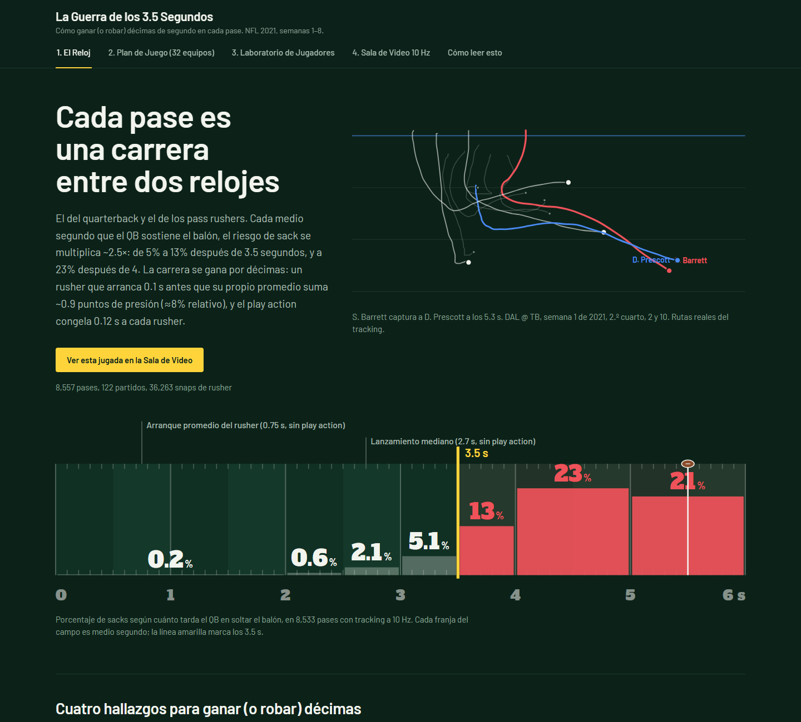

# La Guerra de los 3.5 Segundos

> Tiempo de lanzamiento y pass rush · NFL 2021, semanas 1–8 · Hackathon NFL Big Data Bowl, UNAM

Análisis de la relación entre el tiempo de lanzamiento del quarterback y la presión defensiva a partir de tracking a 10 Hz (**8,557 pases, 36,263 snaps de pass rush, 122 partidos**) y PFF Scouting, estructurado para decisiones de coordinadores y jugadores.

## Hallazgo principal

**Pasados los 3.5 segundos, los sacks se aceleran rápidamente y las décimas definen la jugada.** Cada medio segundo extra que el QB sostiene el balón, la tasa de sack se multiplica ~2.4×: de 5.1% (3.0–3.5 s) a 13.2% (3.5–4.0 s) y 23.4% (4.0–5.0 s). En esa ventana, un rusher que arranca 0.1 s antes que su propia mediana aporta ~0.9 pts de presión (≈8% relativo), mientras el play action retrasa 0.12 s el arranque de cada rusher.

| Hallazgo | Evidencia (ajustada: mismo down y distancia, mismo jugador) | Confianza |
|---|---|:---:|
| **Sacks y éxito después de 3.5 s** | Sacks: 1.9% antes vs 19.2% después; éxito: 52.8% → 35.9%. Uno de cada cuatro pases (25.5%) supera los 3.5 s | 🟢 |
| **Arranque del rusher (get-off)** | Mismo jugador: 0.3 s antes que su mediana → 21.3% de presión; 0.3 s después → 7.4%. Métrica más estable del dataset (r = 0.79 entre mitades) | 🟢 |
| **Play action y jugadas largas** | Jugadas de 20+ yardas: 13.6% vs 7.7% esperado (1.8×), sin cambio en éxito (54.1% vs 54.1%). Costo: más presión (37.8% vs 30.5%) | 🟢 |
| **Efecto del blitz por down** | Reduce el éxito rival en 1ro/2do (−2.3 pts) y 3ro corto (−5.2). En 3ro y 7+ sube los sacks (9.5% → 15.1%, z = 2.6) pero también las conversiones (**+4.5 pts**; sin sack: 42.5% vs 35.1%, z = 2.2; cobertura hombre a hombre: 57.8% vs 27.1%), aunque ahí se manda más (30% vs 22%) | 🟡 |



## Para quién y qué decisión cambia

| Audiencia | Decisión | Respaldo |
|---|---|---|
| **Coordinador defensivo** | Reservar el blitz para 1ro/2do y 3ro corto; en 3ro y largo priorizar rush de 4 con stunt | En 3ro y 7+, vs rush de 4 sin stunt (29.4% de conversión, n = 541): 4 con stunt −4.6 pts (ee 3.1, muestra chica); blitz sin stunt −0.7; blitz con stunt +4.7 |
| | Medir y entrenar el get-off de cada rusher frente a su propia mediana | 0.7–1.2 pts de presión por cada 0.1 s bajo todos los controles (ver tabla abajo) |
| | Atacar el carril más vulnerable de la línea rival | El plan de juego muestra presión permitida por carril con su `n` (tendencia: se repite en 12 de 32 equipos, ~2× el azar) |
| **Coordinador ofensivo** | Usar play action para buscar yardas largas; combinar con rollout diseñado si la prioridad es reducir sacks | PA + rollout: 2.7% de sacks (10 de 365) vs 7.3% desde el pocket (−4.9 pts, z = −4.0), con 9.9% vs 14.4% de jugadas de 20+ yd (−5.1 pts, z = −2.7) |
| | Evitar dejar al corredor solo recogiendo blitz | El RB en recogida de blitz pierde 26.0% de sus duelos (n = 800) vs 13.8% de la línea. Enviarlo a ruta no empeora: +4.0 pts de éxito (ee 2.4) |
| | Diseñar lecturas con salida antes de 3.5 s | Liga: 52.8% de éxito antes de 3.5 s vs 35.9% después |
| **Jugadores** | Rusher: trabajar el get-off dentro del grupo posicional (Edge ~0.75 s, Interior ~0.83 s) | Edge: +1.6 pts de presión por 0.1 s; Interior: +0.8 (con controles) |
| | QB: controlar el tiempo de retención del balón | El % de pases > 3.5 s es estable entre mitades de temporada (r = 0.64) |

### Vistas de la aplicación

1. **El Reloj**: resumen de hallazgos, curva de sacks y éxito por tiempo de lanzamiento, efecto del get-off por jugador, planes de rush ajustados, blitz por down y play action frente a lo esperado.
2. **Plan de Juego**: perfil de cada uno de los 32 equipos con presión permitida por carril de línea ofensiva (`n` y presiones), reloj del QB rival, get-off defensivo (tendencia), uso de play action y ajustes tácticos. Incluye botón opcional de resumen con Amazon Nova (y respaldo analítico local).
3. **Jugadores**: ranking de get-off con filtro `Todos / Edge / Interior`, columna Strain, tiempo de lanzamiento de quarterbacks y mejores bloqueadores de pase.
4. **Sala de Video**: animación a 10 Hz con reloj del pocket, telemetría con marcas en 3.5 s y en el fin del dropback, get-off por rusher y 8 jugadas destacadas.
5. **Cómo leer esto**: glosario de términos de NFL y criterios estadísticos para lectores sin experiencia previa en fútbol americano.

## Metodología

- **Datos**: NFL Big Data Bowl 2023 (8,557 dropbacks, 188,254 registros de PFF Scouting y tracking a 10 Hz de 122 partidos, 811 MB).
- **Pipeline reproducible**: [backend/pipeline/build_tracking_features.py](backend/pipeline/build_tracking_features.py) calcula por jugada el tiempo de lanzamiento y por rusher el get-off, velocidad a 0.5 s, strain y distancia mínima al QB. La API carga esos archivos al arrancar y computa todos los agregados en memoria (sin cifras escritas a mano en la UI).
- **Definiciones**: *presión* = golpe, apuro o sack; *éxito* = 40% de las yardas en 1er down, 60% en 2do y 100% en 3ro/4to; *jugada grande* = 20+ yardas; *blitz* = 5+ rushers; *stunt* = jugada con switch (`SW`); *get-off* = segundos del snap a 1 yarda recorrida; *% completos* = completos / intentos (excluyendo sacks y scrambles). Se excluyen los 35 intentos de 2 puntos de todo cálculo de éxito.
- **Controles**: las jugadas dependientes de situación (play action, blitz, stunts) se comparan dentro del **mismo down y yardas exactas por avanzar** con errores estándar estratificados. Las métricas de jugador usan efectos fijos por jugador y comparaciones dentro de su grupo posicional.
- **Robustez del get-off** (puntos de presión por cada 0.1 s más rápido; base 11.0%; errores agrupados por jugador):

| Controles | pts por 0.1 s | z |
|---|---:|---:|
| Mismo jugador | 0.87 | 9.3 |
| + down y distancia exacta | 0.70 | 7.4 |
| + franja de tiempo de lanzamiento | 1.23 | 12.2 |
| + play action | 1.08 | 9.9 |
| + blitz / stunt | 1.07 | 9.8 |
| Contra sus compañeros en el mismo snap | 0.89 | 7.4 |

- **Estabilidad (semanas 1–4 vs 5–8)**: get-off por jugador r = 0.79 · % de pases del QB > 3.5 s r = 0.64 · mediana de lanzamiento del QB r = 0.50 · presión propia del rusher r = 0.31 (moderada). El get-off defensivo por equipo (r = 0.42) y el carril débil de la línea se etiquetan como **tendencia**.
- **Alcance de los 3.5 s**: funciona como referencia operativa sobre una curva continua, no como un quiebre abrupto. El éxito cae ~8 pts por segundo y agregar un quiebre en 3.5 s no mejora significativamente una recta (F = 2.9, p ≈ 0.09); lo que se acelera es la tasa de sack (×3.3, ×2.5, ×2.6 y ×1.6 por cada 0.5 s entre 2.0 y 4.5 s).

## Lo que descartamos

Hipótesis evaluadas con los mismos datos que no cumplieron el estándar de evidencia:

- **"Dos dobles en 5 contra 4 dejan un rusher libre el 100% de las veces"**: es aritmética (781 de 781 jugadas) y 53% son stunts mal clasificados porque PFF solo registra al primer defensor bloqueado.
- **"Trench Gravity" (estrellas que generan presión indirecta)**: la presión de compañeros cuando un liniero recibe doble marca no es estable entre mitades (r = −0.12).
- **"Blitz en 3ro y largo como jugada definitiva"**: eleva los sacks, pero también las conversiones (+4.5 pts a igual distancia).
- **"Rollout a la derecha da 6.4× menos sacks"**: selección sesgada de un solo lado (derecha 1.1%, n = 285; izquierda 5.4%, n = 149). Considerando ambos lados: 2.5% vs 6.7% desde el pocket tradicional.
- **"El play action sube el éxito de 47% a 54%"**: artefacto de down (40% en 1er down vs 4% en 3ro, donde la exigencia es distinta). En el mismo down y distancia: 54.1% vs 54.1%, con +7.3 pts de presión ajustada.
- **"Cada QB cae distinto después de 3.5 s"**: la caída individual de éxito no se repite entre mitades (r = −0.14). Solo el tiempo que sostiene el balón es estable.
- **"Tackles pesados pierden contra rushers ligeros"** (15.0% vs 6.5% de duelos perdidos): confusión por posición (96% de esos rivales son edges vs 14%). Frente al mismo rusher, más peso reduce las pérdidas (−0.9 pts por cada 10 lb, z = −3.3).
- **"Presión fantasma"** (rusher a 2–3 yd sin presión oficial baja completos de 71.0% a 64.9%): explicado por el reloj; dentro de la misma franja de lanzamiento baja a −2.6 pts y deja de ser significativo (ee 1.5).
- **Fatiga del rusher**: la presión aumenta con los snaps del partido (11.3% en los primeros 10 vs 15.2% tras 30), incluso comparando al mismo jugador.
- **Ruido del estadio**: efecto mínimo (37.7% presión permitida de local vs 36.6% de visitante).
- **Vulnerabilidad de equipo a stunts**: no es estable entre mitades (r = 0.15).

## Cómo correrlo

```powershell
# 1. Verificar el entorno
.\.hackathon\setup.cmd --check

# 2. Backend (terminal 1), puerto 8000
.\.venv\Scripts\uvicorn backend.main:app --reload

# 3. Dashboard (terminal 2): abre http://localhost:5173
cd dashboard
npm run dev
```

Los archivos de [backend/precomputed/](backend/precomputed/) ya vienen incluidos. Para regenerarlos desde el tracking (~1–2 min): `.\.venv\Scripts\python -m backend.pipeline.build_tracking_features`.

**Stack**: FastAPI + pandas en `backend/` (sin escrituras a disco; `data/` es solo lectura) y React + Vite + TypeScript + Tailwind 3 + Recharts en `dashboard/`. IA opcional con Amazon Bedrock (Amazon Nova): la app muestra su hallazgo completo aunque la IA no esté disponible.

**API**: `GET /health` · `/api/guerra` · `/api/qb-clocks` · `/api/players` · `/api/team/{equipo}` · `/api/plays` · `/api/play/{gameId}/{playId}/tracking` · `POST /api/coach-brief`.

## Capturas

**Plan de Juego**: carriles de la línea ofensiva, reloj del QB rival y pistas para ambos lados del balón.


**Sala de Video 10 Hz**: el reloj del pocket en rojo después de 3.5 s.


