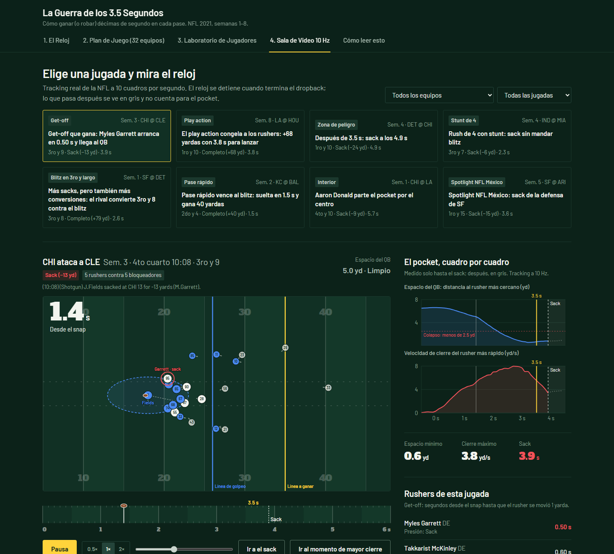
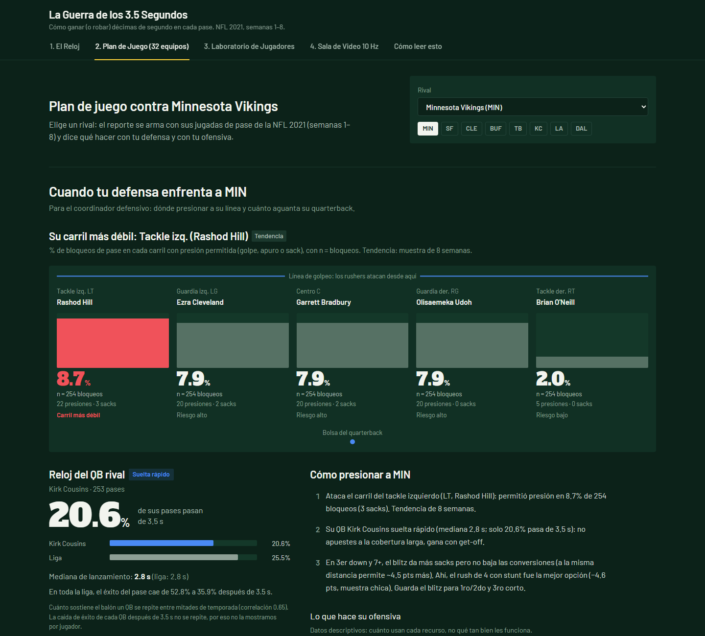

# La Guerra de los 3.5 Segundos

**Cada pase de la NFL es una carrera contra el reloj: medimos con tracking a 10 Hz quién gana las décimas de segundo y cómo convertirlas en jugadas.**

Hackathon NFL Big Data Bowl, UNAM. Temporada 2021, semanas 1–8: 8,557 pases, 122 partidos y 36,263 snaps de pass rusher con tracking. ¿No conoces la NFL? Abre la pestaña **"Cómo leer esto"** del dashboard: es un glosario de una línea por término.

## Hallazgo principal

> Cada pase es una carrera entre dos relojes: el del quarterback y el de los pass rushers. Cada medio segundo que el QB sostiene el balón, el riesgo de sack se multiplica ~2.5×: de 5% a 13% después de 3.5 segundos, y a 23% después de 4. La carrera se gana por décimas: un rusher que arranca 0.1 s antes que su propio promedio suma ~0.9 puntos de presión (≈8% relativo), y el play action congela 0.12 s a cada rusher.

| Hallazgo | Evidencia (ajustada cuando aplica) | Confianza |
|---|---|---|
| **La presión decide la jugada** | Éxito del pase 57.0% → 34.1% con presión; pases completos 67.8% → 46.6% | 🟢 robusto |
| **Zona de peligro después de 3.5 s** | Sacks: 5.1% (3.0–3.5 s) → 13.2% (3.5–4 s) → 23.4% (4–5 s). El riesgo crece ~2.5× cada medio segundo y el éxito cae de forma continua (~7 pts por segundo). Las jugadas grandes llegan a su máximo justo antes, entre 3.0 y 3.5 s (14.8%) | 🟢 robusto |
| **El get-off gana** | El mismo rusher: arrancando 0.3 s antes que su mediana genera 21.3% de presión; 0.3 s después, 7.4%. ~0.9 pts por cada 0.1 s sobre una base de 11.0%. Se repite entre mitades de temporada (0.79) | 🟢 robusto |
| **El play action es el arma de la jugada grande** | A la misma down y distancia exacta: jugadas de 20+ yardas 13.6% vs 7.7% (1.8×) con el mismo éxito (54.1% vs 54.1%). Congela 0.12 s a cada rusher, pero el amague cuesta tiempo: más presión (37.8% vs 30.5%) y sacks (6.5% vs 4.2%). Con rollout diseñado, los sacks bajan a 2.7% (vs 7.2%) | 🟢 robusto |
| **El blitz depende del down** | A la misma distancia exacta: −2.3 pts de éxito del rival en 1ro/2do, −5.2 en 3ro/4to y 1–3, −1.4 en 4–6, pero **+4.5 pts de conversiones en 3ro/4to y 7+**, aunque da más sacks (9.5% → 15.1%). Y ahí es donde más se usa (30% vs 22%). El cambio entre situaciones está en el límite de la significancia (6.7 pts, z≈2.0) | 🟡 moderado |
| **Rush de 4 con stunt ≈ blitz, sin quitar gente de la cobertura** | Ajustado por down y distancia: −2.4 pts de éxito del rival vs −2.9 del blitz sin stunt. En 3ro y 7+ fue la mejor estimación (muestra chica, no concluyente) | 🟡 moderado |
| **Cuánto sostiene el balón cada QB** | El % de pases que pasan de 3.5 s es un rasgo del QB: se repite entre mitades de temporada (0.65). En la liga, 25.5% de los pases pasan de 3.5 s, y el éxito cae de 52.8% a 35.9% | 🟢 robusto |
| **Eslabones débiles en la protección** | El corredor recogiendo blitz pierde 26.0% de sus duelos; la línea ofensiva, 13.9%. Mandarlo a la ruta contra el blitz no empeora el resultado | 🟡 moderado |
| **Carril débil de la línea por equipo** | El carril más débil se repite entre mitades en 12 de 32 equipos (~2× el azar): lo mostramos como tendencia, siempre con su `n` | 🟡 moderado |

## Para quién y qué decisión cambia

- **Coordinador defensivo.** Usa el blitz en 1ro/2do y en 3ro corto, no en 3ro y largo: ahí da más sacks pero también más conversiones. En 3ro y largo, el rush de 4 con stunt fue la mejor opción (muestra chica). Entrena el get-off: es la habilidad más estable de un rusher y cada décima cuenta. El Plan de Juego de los 32 equipos te dice qué carril atacar y cuánto sostiene el balón el QB rival.
- **Coordinador ofensivo.** Usa el play action para buscar la jugada grande, no para "subir el éxito", y combínalo con rollout para bajar los sacks. No dejes al corredor solo recogiendo el blitz. Diseña lecturas que salgan antes de 3.5 s.
- **Jugadores.** Rushers: tu get-off contra tu propio promedio, jugada por jugada, en la Sala de Video. QB: cuánto sostienes el balón y qué pasa con tus pases después de 3.5 s.

## Cómo lo medimos

- **Datos.** Tracking a 10 Hz (811 MB, 122 partidos, del snap al final del dropback) más el scouting de PFF por jugador y jugada. Las variables de tracking por jugada y por rusher se precalculan con un script reproducible y la API calcula todos los agregados al arrancar.
- **Definiciones.** *Presión*: golpe, apuro o sack. *Éxito*: ganar 40% de la distancia en 1er down, 60% en 2do y 100% en 3ro/4to. *Jugada grande*: 20+ yardas. *Blitz*: 5 o más rushers. *Stunt*: dos rushers cruzan carriles. *Tiempo de lanzamiento*: del snap al pase, sack o carrera del QB. *Get-off*: segundos tras el snap hasta que el rusher se movió 1 yarda, comparado siempre dentro de su grupo (Edge = DE·OLB, Interior = DT·NT). *% de completos*: completos entre intentos (sin contar sacks ni scrambles). Excluimos los 35 intentos de 2 puntos de todo cálculo de éxito.
- **El jugador contra sí mismo.** El efecto del get-off se mide dentro del mismo jugador y es robusto: 0.7–1.2 pts de presión por cada 0.1 s con controles de down y distancia, tiempo de lanzamiento, play action, blitz/stunt y compañeros en la misma jugada (z ≥ 7 con errores agrupados por jugador). Edge 1.6 pts, Interior 0.5.
- **Situación comparable.** Todo lo que se usa más en un down que en otro (play action, blitz) se compara a la misma down y yardas por avanzar exactas. Así descubrimos que el play action no sube el éxito: compra jugadas grandes.
- **Estabilidad.** Una métrica de jugador o equipo solo se muestra si se repite entre las semanas 1–4 y 5–8: get-off 0.79, % de pases del QB después de 3.5 s 0.65.
- **Nota honesta.** 3.5 s es un umbral útil para decidir, no un muro: el riesgo de sack crece de forma continua (~2.5× por medio segundo) y no hay un quiebre estadístico en ese punto.

## Lo que descartamos

Hipótesis que probamos con los mismos datos y no pasaron el estándar de evidencia:

- **"Dos dobles marcas en protección de 5 contra 4 dejan un rusher libre el 100% de las veces"**: es aritmética (ninguna de 781 jugadas podía salir distinto) y 53% de esas jugadas son stunts mal registrados, porque PFF solo anota el primer defensor bloqueado.
- **Puntaje de "gravedad" y "estrellas invisibles"** que atraen dobles marcas: no se repite entre mitades de temporada (−0.12).
- **"Blitz en 3ro y largo, golpe de gracia"**: da más sacks, pero también más conversiones a la misma distancia.
- **"Rollout a la derecha: 6.4× menos sacks"**: escogido a conveniencia (a la izquierda, 5.4%). Lo defendible son los rollouts diseñados de ambos lados: 2.5% de sacks vs 6.7% (y dentro del play action, 2.7% vs 7.2%).
- **"El play action sube el éxito"**: es un efecto del down (se usa en 40% de los pases de 1ro y en 4% de los de 3ro). A la misma down y distancia: 54.1% vs 54.1%. Tampoco tiene "la misma presión": ajustado, tiene más.
- **"Cada QB tiene su propio reloj"**: la caída del éxito después de 3.5 s por QB no se repite entre mitades (−0.13) y no se distingue del ruido. Lo que sí se repite es cuánto sostiene el balón.
- **"Los tackles pesados pierden contra rushers ligeros"**: confusión por tipo de rusher (los ligeros son edges, mejores para presionar). Con el mismo rusher, un tackle más pesado pierde *menos*.
- **"A los 3.5 s hay un muro"**: no hay quiebre estadístico; es un umbral útil en una curva continua.
- **"Presión fantasma"** (rushers cerca del QB sin presionar bajan el % de completos): desaparece al comparar el mismo tiempo de lanzamiento.
- **Fatiga del rusher**: la presión *sube* con los snaps, por sesgo de selección (las estrellas juegan más).
- **Ruido del estadio**: efecto mínimo.
- **Vulnerabilidad de un equipo a los stunts**: no se repite entre mitades de temporada (0.15).

## Cómo correrlo

Stack fijo del evento: FastAPI + pandas en `backend/`, React + Vite + TypeScript + Tailwind 3 + Recharts en `dashboard/`. El resumen del coordinador con Amazon Nova es opcional: sin IA, la app usa un respaldo determinista y muestra todos los hallazgos.

```powershell
# 1. Verificar el entorno y las reglas
.\.hackathon\setup.cmd --check

# 2. Backend (terminal 1, puerto 8000)
.\.venv\Scripts\uvicorn backend.main:app --reload

# 3. Dashboard (terminal 2): abre http://localhost:5173
cd dashboard
npm run dev

# 4. Generar el zip de entrega
.\.hackathon\setup.cmd --entregar
```

En macOS/Linux: `sh .hackathon/setup.sh --check`, `.venv/bin/uvicorn backend.main:app --reload` y `sh .hackathon/setup.sh --entregar`.

Las variables de tracking de `backend/precomputed/` (`tracking_plays.csv` y `tracking_rushers.csv`) se versionan y la app solo las lee. Para regenerarlas desde los 122 archivos de tracking (~1–2 min):

```powershell
.\.venv\Scripts\python -m backend.pipeline.build_tracking_features
```

## Capturas

**El Reloj**: la zona de peligro, el get-off y la apuesta del blitz.


**Sala de Video 10 Hz**: la jugada real con el reloj del pocket y el get-off de cada rusher.



**Plan de Juego (32 equipos)**: el carril débil de la línea y el reloj del QB rival.


